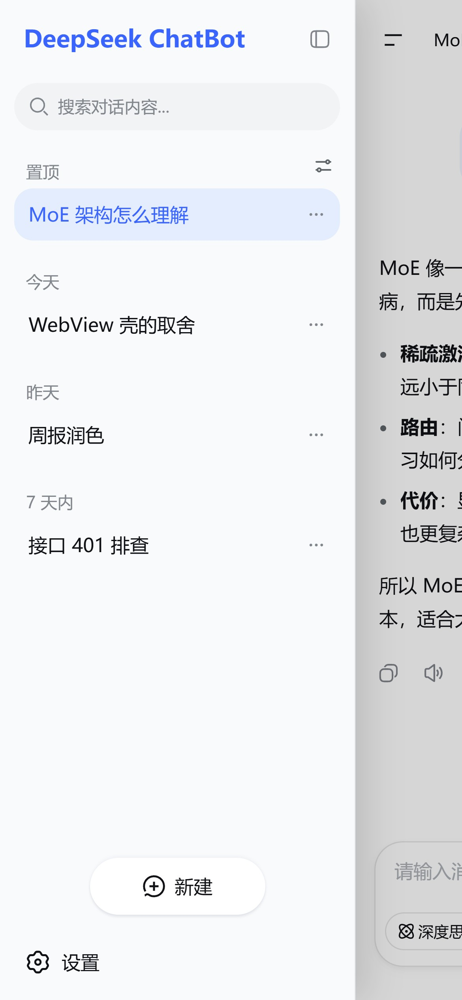

# DeepSeek ChatBot (Android)

English | [简体中文](README.md)

<p align="center">
  
</p>

[](https://github.com/Jay-Victor/DeepSeek-ChatBot/releases/latest)
[](https://github.com/Jay-Victor/DeepSeek-ChatBot/releases/latest)
[](https://www.deepseek.com/)

Packs [deepseek-ai/chat-demo](https://github.com/deepseek-ai/chat-demo) 0.1.3 into an installable Android app:
**the upstream web build, wrapped in a thin Kotlin WebView shell**. No UI rewrite, no protocol changes.

| Chat | Sidebar |
| :---: | :---: |
|  |  |

| Settings · General | Settings · About |
| :---: | :---: |
|  |  |

| | |
| --- | --- |
| Application ID | `com.deepseekchatbot` |
| Version | 0.1.12 (versionCode 13) |
| Size | 5.34 MB (release) |
| SDK | minSdk 26 / targetSdk 36 / compileSdk 36 |
| Native deps | androidx only (webkit / browser / activity / core-splashscreen), no third-party runtime |
| Toolchain | Gradle 8.14.4 · AGP 8.13.0 · Kotlin 2.3.0 · JDK 17+ |

## Features

### From upstream

- Multiple sessions with auto-generated titles, edit / regenerate / branch switching
- Streaming answers, deep thinking, web search with source citations
- Attachments (paste / drag-drop), voice input and read-aloud
- Open attachments directly: images and PDFs in a new tab, SVG and other files downloaded; search results, citations and page links accept HTTP(S) only
- Images with a long edge over 4096 px are downscaled before upload; historical images are re-uploaded automatically
- Markdown / syntax highlighting / KaTeX / Mermaid
- Chinese and English, light and dark themes, ZIP history import/export

### Added by the shell

- **System capabilities**: back button, status bar appearance, safe areas and keyboard avoidance, microphone, file picker, external links
- **Voice input**: circled sound-wave entry; tapping switches to "Hold to talk" — hold to record, release to transcribe and send, swipe up to cancel, with a live spectrum overlay
- **Attachment panel**: circled plus opens a panel with recent photos plus Camera / Photos / Files
- **Update prompt**: tapping the new-version prompt opens Settings → About
- **Attachment preview**: images open in a full-screen in-app preview (tap to toggle actual size), PDFs go to the system viewer (fallback to SAF save), SVG and other files are saved through SAF
- **Export**: ZIP and attachment downloads use SAF (WebView drops `blob:` downloads); the save bridge creates documents with the right MIME type
- **Mobile sidebar**: session search (title + current branch text, highlighted hits), floating New button, multi-select with batch pin/delete
- **Session header**: auto-read toggle; reads each completed reply aloud and shows a 1.6-second centered hint when toggled
- **Session menu**: pin / unpin and multi-select
- **Settings & About**: auto-collapse thinking, context-usage ring (DeepSeek-V4 tokenizer, 1M window), version and update check, in-app install

## Quick start

Download the signed APK from [Releases](https://github.com/Jay-Victor/DeepSeek-ChatBot/releases/latest), or:

```bash
adb install -r DeepSeekChatBot-v0.1.12-release.apk
```

On first launch, add your DeepSeek API key in Settings → Data. The key is written only to the on-device WebView localStorage and is excluded from cloud backup (`allowBackup=false`).

**The same `applicationId` must always be signed with the same keystore** — otherwise the only option is uninstall and reinstall, which wipes local sessions and the API key.

## Why a WebView shell

The upstream project is a pure static SPA: `rspack` emits static files, there is no backend, all state lives in localStorage and IndexedDB, and requests go straight to the DeepSeek API. Getting it into a WebView only needs six kinds of capabilities a browser has and a WebView does not. Rewriting it in Kotlin would mean reimplementing Markdown, KaTeX, Mermaid, and the whole history import/export layer for no gain. So the shell only fills the gaps.

## Build

Requirements:

- Node.js 22+ and pnpm
- JDK 17+ (this repository was built with 21)
- Android SDK: platform `android-36`, build-tools `36.1.0`

```bash
scripts/build-apk.sh release        # or scripts/build-apk.sh debug
```

The script does three things: `pnpm build` inside `web/`, sync `web/dist` into `android/app/src/main/assets/www`, then `./gradlew assembleRelease`. Output:

```
android/app/build/outputs/apk/release/DeepSeekChatBot-v0.1.12-release.apk
```

Step by step:

```bash
cd web && pnpm install && pnpm build
rm -rf ../android/app/src/main/assets/www && mkdir -p ../android/app/src/main/assets/www
cp -r dist/. ../android/app/src/main/assets/www/
cd ../android && ./gradlew assembleRelease
```

> Do not serve `web/dist` from a static server while building: rspack cleans the output directory and fails with `EBUSY` on Windows.

## Signing

`android/local.properties` (gitignored, template at `android/local.properties.template`) supplies four values:

```
KEYSTORE_FILE / KEYSTORE_PASSWORD / KEYSTORE_ALIAS / KEY_PASSWORD
```

If any of them is missing, `assembleRelease` still produces an APK, just unsigned. The keystore generated for this repository is recorded in `android/KEYSTORE_INFO.txt` (also gitignored) — back it up, or you lose the ability to upgrade in place.

## What the shell implements

| Problem | Solution |
| --- | --- |
| Page origin | `WebViewAssetLoader` serves `assets/www` from the fixed `https://appassets.androidplatform.net/assets/www/index.html`. `file://` is not usable: Chromium disables IndexedDB there, and `crypto.randomUUID`, `navigator.clipboard`, `getUserMedia` all require a secure context |
| Microphone | `onPermissionRequest` plus a runtime `RECORD_AUDIO` request |
| File picker | `onShowFileChooser` + `ACTION_OPEN_DOCUMENT`, mapping the page's extension allow-list to MIME types |
| ZIP export | A WebView silently drops `<a download>` on `blob:` URLs; the shell exposes a JS→native bridge that streams base64 chunks into SAF `ACTION_CREATE_DOCUMENT` |
| External links | `window.open` / `target=_blank` / plain links all open in Custom Tabs instead of a second WebView |
| Back button | The page pushes its "overlay open" state to native, which decides synchronously whether to close or exit (no async JS callback) |
| System bars and keyboard | Container padding reserves status bar, navigation bar and IME height; status bar icons follow the page theme |
| Light/dark | `values/` uses a light base theme, `values-night/` a dark one — WebView derives `prefers-color-scheme` from the app theme, not from system uiMode |

## Known limitations

- **Auto-read makes TTS requests**: one per completed reply, off by default; only for the active chat, only when visible, and it does not interrupt an ongoing reading
- **Session search, pinning and multi-select are mobile-only**: search matches titles, current branch text and attachment names, not thinking blocks; the first search builds a local index, so a large history may pause briefly
- **Background / lock screen**: the system throttles WebView, so long generations may be interrupted. Keeping it running while locked needs a foreground service, which is not implemented
- **System dark mode**: the page renders with the theme present at launch (`configChanges` includes `uiMode` so the activity is never recreated and streaming survives). A system theme switch takes effect on the next launch; the in-app Settings → Theme switch applies immediately
- **Animated images over 4096 px** lose their animation when downscaled before upload (upstream behaviour)
- **Recent photos need photo permission**: when denied the strip shows a retry action; Camera / Photos / Files still work
- **Android's accessibility "force enable zoom" can still magnify the page**: pinch zoom is disabled inside the WebView, but system accessibility is outside app control
- **PDF opening depends on a system viewer**: without one the app opens a save-location picker instead; the file is still written normally
- Large attachments (tens of MB) go through SAF into memory before upload; low-end devices risk OOM (`largeHeap` is enabled, which only helps)
- DeepSeek endpoints only (`/anthropic/v1/messages`, `/anthropic/v1/files`, `/v1/tools/asr|tts`). Supporting an OpenAI-compatible endpoint means changing `web/src/services/api/`
- In-app updates need access to GitHub release assets (the `api.github.com` asset endpoint is preferred). On restricted networks the download may fail; use "Download in browser" instead. The first install also requires allowing unknown sources in system settings
- No iOS build: the same six capabilities would need a separate implementation there

## Verification status

Checked on Android 16 (API 36.1, x86_64 emulator) for the shell: page origin and secure context, CORS on the streaming endpoint and 401 error mapping, ZIP export written to disk (downloaded file md5 matches the source data), microphone permission flow, file picker, external links opening in Custom Tabs, all three levels of back button behaviour, light/dark with status bar inversion, insets/keyboard without double spacing, and in-app update download progress / SHA-256 and signature verification / unknown-sources permission / system installer upgrade.

v0.1.9's mobile sidebar (search, multi-select, pinned group, batch delete, floating New, persistent header button), session menu (pin / unpin / multi-select) and auto-read toggle (including the 1.6-second centered hint and the auto-read trigger) were checked in a 390×844 viewport; real audio output and the Android IME behaviour still need an on-device check.

v0.1.10 was checked on Android 16 (API 36.1, x86_64 emulator): a 6000×3000 image is downscaled to 4096×2048 before upload, a historical image with its `serverId` cleared is re-uploaded and gets a new ID, chat and draft images open in the in-app preview (back button closes, tap toggles actual size), PDFs reach the system viewer, SVG saves through SAF byte-for-byte, the exported ZIP re-downloads with a valid CRC and the original image bytes, and `javascript:` search results / page links never become clickable anchors; all 12 `isWebUrl` cases pass. Real-device network and IME behaviour are covered by the pre-release device check.

v0.1.11 was checked on Android 16 (emulator): the circled sound-wave entry and Hold to talk switch, the recording overlay and swipe-up cancel, auto-send after a mocked ASR transcript, and switching back to the keyboard; the circled-plus attachment panel with granted / denied photo permission, recent-photo taps, camera capture, Photos, Files and back-button dismissal; and a mocked new release whose whole toast opens Settings → About. Real-device camera, photo permission and IME behaviour await the device check.

v0.1.12 fixes page-level pinch zoom: the viewport now sets `maximum-scale=1,user-scalable=no` and the WebView disables `supportZoom`. A CDP two-finger gesture took `visualViewport.scale` from 1 to 5 before the fix and leaves it at 1 after; the image preview's tap-to-actual-size is unaffected.

## Repository layout

```
web/        upstream chat-demo 0.1.3 sources; see web/PATCHES.md for local changes
android/    Kotlin WebView shell (Gradle project)
scripts/    build-apk.sh: build web → sync assets → build APK
docs/       screenshots and per-version release notes
references/ upstream archive and icon assets (not tracked)
```

## License

[MIT](LICENSE). `web/` is a derived copy of [deepseek-ai/chat-demo](https://github.com/deepseek-ai/chat-demo); its MIT notice is kept in `web/LICENSE` and ships with the build output. The icon artwork and the DeepSeek name are used for a personal, side-loaded build only.

See [CHANGELOG.md](CHANGELOG.md) for history.
