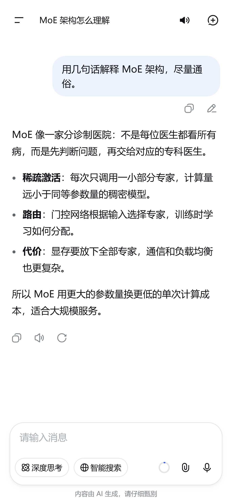
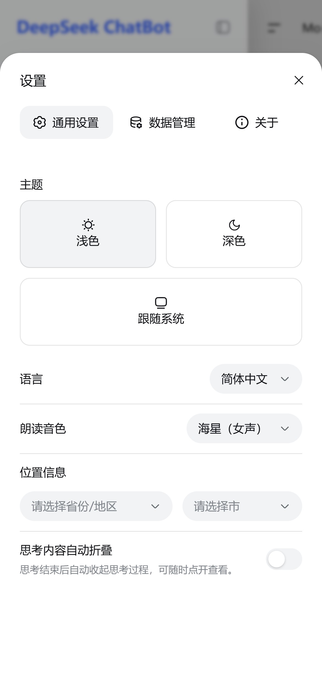
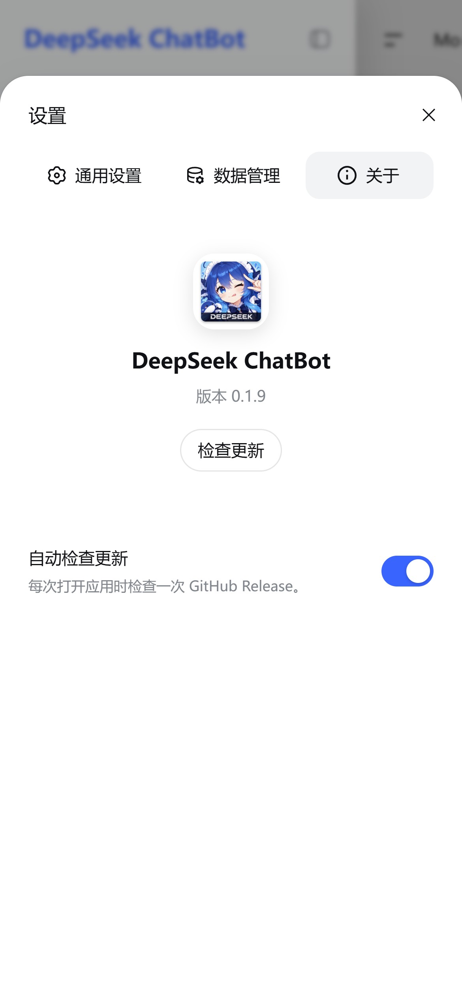

# DeepSeek ChatBot (Android)

English | [简体中文](README.md)

<p align="center">
  
</p>

[](https://github.com/Jay-Victor/DeepSeek-ChatBot/releases/latest)
[](https://github.com/Jay-Victor/DeepSeek-ChatBot/releases/latest)
[](https://www.deepseek.com/)

Packs [deepseek-ai/chat-demo](https://github.com/deepseek-ai/chat-demo) 0.1.3 into an installable Android app:
**the upstream web build, wrapped in a thin Kotlin WebView shell**. No UI rewrite, no protocol changes.

| Chat | Sidebar |
| :---: | :---: |
|  |  |

| Settings · General | Settings · About |
| :---: | :---: |
|  |  |

| | |
| --- | --- |
| Application ID | `com.deepseekchatbot` |
| Version | 0.1.22 (versionCode 23) |
| Size | 5.64 MB (release) |
| SDK | minSdk 26 / targetSdk 36 / compileSdk 36 |
| Native deps | androidx only (webkit / browser / activity / core-splashscreen), no third-party runtime |
| Toolchain | Gradle 8.14.4 · AGP 8.13.0 · Kotlin 2.3.0 · JDK 17+ |

## Features

### From upstream

- Multiple sessions with auto-generated titles, edit / regenerate / branch switching
- Streaming answers, deep thinking, web search with source citations
- Attachments (paste / drag-drop), voice input and read-aloud
- Open attachments directly: images and PDFs in a new tab, SVG and other files downloaded; search results, citations and page links accept HTTP(S) only
- Images with a long edge over 4096 px are downscaled before upload; historical images are re-uploaded automatically
- Markdown / syntax highlighting / KaTeX / Mermaid
- Chinese and English, light and dark themes, ZIP history import/export

### Added by the shell

- **System capabilities**: back button, status bar appearance, safe areas and keyboard avoidance, microphone, file picker, external links
- **Voice input**: circled sound-wave entry; tapping switches to "Hold to talk" — hold to record, release to transcribe and send, swipe up to cancel, with a live spectrum overlay
- **Read-aloud engine**: Settings → General offers Online (the stella / tide DeepSeek voices) or Local (the system text-to-speech engine, 0.5–2.0× speed with a preview button); local reading works offline, makes no TTS request, and is also available on custom, Anthropic and OpenAI profiles
- **Attachment panel**: circled plus opens a panel with recent photos plus Camera / Photos / Files
- **Update prompt**: tapping the new-version prompt opens Settings → About
- **Attachment preview**: images open in a full-screen in-app preview (tap to toggle actual size), PDFs go to the system viewer (fallback to SAF save), SVG and other files are saved through SAF
- **Export**: ZIP and attachment downloads use SAF (WebView drops `blob:` downloads); the save bridge creates documents with the right MIME type
- **Mobile sidebar**: session search (title + current branch text, highlighted hits), floating New button, multi-select with batch pin/delete
- **Session header**: auto-read toggle; reads each completed reply aloud and shows a 1.6-second centered hint when toggled
- **Message navigator & back to top**: a right-edge rail marks questions with dots and answers with ticks (ticks drop out on dense chats); tap to jump, drag to scrub, hover or drag for a text preview. Double-tap the chat title to return to the earliest message; a floating Back to bottom button appears once you leave the bottom
- **Session menu**: pin / unpin and multi-select
- **Settings & About**: auto-collapse thinking, context-usage ring (DeepSeek-V4 tokenizer, per-model window), version and update check, in-app install
- **Support the author**: WeChat Pay and Alipay tip posters at the bottom of About; tap for a full-screen view, or save one to the system gallery (`Pictures/DeepSeek ChatBot`) and pick it from the gallery in WeChat / Alipay. Android 10+ needs no storage permission
- **API profiles**: Data settings stores multiple endpoints (DeepSeek / Anthropic / OpenAI-compatible) with their own API keys; fetch the model list after entering an endpoint and switch models. New chats bind to the profile and model they were created with, so switching the current profile does not retarget old chats
- **Context & compression**: enable auto-compression in Settings with its own threshold / target (defaults 50% / 20%); the usage popover compresses manually, shows progress and the summary, and can undo; the message list marks the compressed boundary
- **Identity statements**: create multiple name + setting profiles in Settings and switch per chat from the header; new chats inherit the default, and the system prompt, usage estimates and compression budget all follow the selected profile
- **Appearance**: image / video wallpapers (one of each is kept), an overlay slider (20% by default), 0–24px blur, and a hue slider for the accent colour with reset. With a wallpaper active, the chat area, header, input and sidebar switch to translucent panels; video wallpapers play muted and loop, and pause in the background

## Quick start

Download the signed APK from [Releases](https://github.com/Jay-Victor/DeepSeek-ChatBot/releases/latest), or:

```bash
adb install -r DeepSeekChatBot-v0.1.22-release.apk
```

On first launch, add your DeepSeek API key in Settings → Data. The key is written only to the on-device WebView localStorage and is excluded from cloud backup (`allowBackup=false`).

**The same `applicationId` must always be signed with the same keystore** — otherwise the only option is uninstall and reinstall, which wipes local sessions and the API key.

## Why a WebView shell

The upstream project is a pure static SPA: `rspack` emits static files, there is no backend, all state lives in localStorage and IndexedDB, and requests go straight to the DeepSeek API. Getting it into a WebView only needs six kinds of capabilities a browser has and a WebView does not. Rewriting it in Kotlin would mean reimplementing Markdown, KaTeX, Mermaid, and the whole history import/export layer for no gain. So the shell only fills the gaps.

## Build

Requirements:

- Node.js 22+ and pnpm
- JDK 17+ (this repository was built with 21)
- Android SDK: platform `android-36`, build-tools `36.1.0`

```bash
scripts/build-apk.sh release        # or scripts/build-apk.sh debug
```

The script does three things: `pnpm build` inside `web/`, sync `web/dist` into `android/app/src/main/assets/www`, then `./gradlew assembleRelease`. Output:

```
android/app/build/outputs/apk/release/DeepSeekChatBot-v0.1.22-release.apk
```

Step by step:

```bash
cd web && pnpm install && pnpm build
rm -rf ../android/app/src/main/assets/www && mkdir -p ../android/app/src/main/assets/www
cp -r dist/. ../android/app/src/main/assets/www/
cd ../android && ./gradlew assembleRelease
```

> Do not serve `web/dist` from a static server while building: rspack cleans the output directory and fails with `EBUSY` on Windows.

## Signing

`android/local.properties` (gitignored, template at `android/local.properties.template`) supplies four values:

```
KEYSTORE_FILE / KEYSTORE_PASSWORD / KEYSTORE_ALIAS / KEY_PASSWORD
```

If any of them is missing, `assembleRelease` still produces an APK, just unsigned. The keystore generated for this repository is recorded in `android/KEYSTORE_INFO.txt` (also gitignored) — back it up, or you lose the ability to upgrade in place.

## What the shell implements

| Problem | Solution |
| --- | --- |
| Page origin | `WebViewAssetLoader` serves `assets/www` from the fixed `https://appassets.androidplatform.net/assets/www/index.html`. `file://` is not usable: Chromium disables IndexedDB there, and `crypto.randomUUID`, `navigator.clipboard`, `getUserMedia` all require a secure context |
| Microphone | `onPermissionRequest` plus a runtime `RECORD_AUDIO` request |
| File picker | `onShowFileChooser` + `ACTION_OPEN_DOCUMENT`, mapping the page's extension allow-list to MIME types |
| ZIP export | A WebView silently drops `<a download>` on `blob:` URLs; the shell exposes a JS→native bridge that streams base64 chunks into SAF `ACTION_CREATE_DOCUMENT` |
| Save image to gallery | The About tip posters go through a JS→native bridge into MediaStore under `Pictures/DeepSeek ChatBot`; Android 10+ uses `RELATIVE_PATH` + `IS_PENDING` with no permission, 8/9 asks for `WRITE_EXTERNAL_STORAGE` on the first save |
| External links | `window.open` / `target=_blank` / plain links all open in Custom Tabs instead of a second WebView |
| Back button | The page pushes its "overlay open" state to native, which decides synchronously whether to close or exit (no async JS callback) |
| System bars and keyboard | Container padding reserves status bar, navigation bar and IME height; status bar icons follow the page theme |
| Light/dark | `values/` uses a light base theme, `values-night/` a dark one — WebView derives `prefers-color-scheme` from the app theme, not from system uiMode |

## Known limitations

- **Online read-aloud makes TTS requests**: one per completed reply, off by default; local read-aloud makes none. It only reads the active chat, only while visible, and does not interrupt an ongoing reading
- **Session search, pinning and multi-select are mobile-only**: search matches titles, current branch text and attachment names, not thinking blocks; the first search builds a local index, so a large history may pause briefly
- **The message navigator only appears when the chat is scrollable and has at least 3 visible messages**: on dense chats the answer ticks are dropped and only question dots remain; hover / drag previews show text only and do not load images or attachments
- **Double-tap-to-top and the navigator follow the current branch's rendered messages**: jumping to history pauses streaming follow until you return to the bottom or tap the last message; the desktop build keeps the native scrollbar and places the rail to its left
- **Background / lock screen**: the system throttles WebView, so long generations may be interrupted. Keeping it running while locked needs a foreground service, which is not implemented
- **System dark mode**: the page renders with the theme present at launch (`configChanges` includes `uiMode` so the activity is never recreated and streaming survives). A system theme switch takes effect on the next launch; the in-app Settings → Theme switch applies immediately
- **Animated images over 4096 px** lose their animation when downscaled before upload (upstream behaviour)
- **Recent photos need photo permission**: when denied the strip shows a retry action; Camera / Photos / Files still work
- **Android's accessibility "force enable zoom" can still magnify the page**: pinch zoom is disabled inside the WebView, but system accessibility is outside app control
- **PDF opening depends on a system viewer**: without one the app opens a save-location picker instead; the file is still written normally
- Large attachments (tens of MB) go through SAF into memory before upload; low-end devices risk OOM (`largeHeap` is enabled, which only helps)
- DeepSeek official endpoints are supported natively (`/anthropic/v1/messages`, `/anthropic/v1/files`, `/v1/tools/asr|tts`); Anthropic and OpenAI-compatible endpoints can be added as API profiles (text + thinking only in this version)
- **Custom endpoints must use HTTPS and allow CORS**: the WebView origin is fixed; if the endpoint does not allow the preflight, requests fail. Enter the API root, without `/v1` or `/anthropic`
- **Non-DeepSeek protocols support text + thinking only in this version**: web search, attachments, speech input and server-side titles degrade by capability; those entries are hidden or disabled on Anthropic / OpenAI endpoints
- **Speech input uses the DeepSeek official endpoint only**: ASR / TTS live under `/v1/tools`; custom DeepSeek endpoints that do not forward that path hide the speech entry. Read-aloud can use the local engine; online reading still requires the official endpoint
- **Local read-aloud depends on the system voice pack**: voice, pauses and usable speed range come from the device engine; when speech data for the current language is missing, install it in the system text-to-speech settings. Code blocks, tables, formulas, images and bare URLs are skipped
- **Context usage is estimated with the DeepSeek-V4 tokenizer**: numbers in the ring and compression preview are approximate on other models
- **API profiles are not included in ZIP export/import**: profiles, keys and default models stay on the device; imported chats fall back to the current profile
- In-app updates need access to GitHub release assets (the `api.github.com` asset endpoint is preferred). On restricted networks the download may fail; use "Download in browser" instead. The first install also requires allowing unknown sources in system settings
- **Compression makes extra model requests**: summaries are generated by the model, so a low threshold or a very long chat increases token usage. Original messages stay local and compression can be undone, but compressed rounds only reach later replies as a summary
- **Compression follows the current branch only**: regenerating, editing or switching branches before the covered point makes the summary inactive; a single summary record is kept, so compressing another branch replaces it
- **ZIP export / import does not carry summaries**: the archive format stays upstream-compatible, so imported chats start with full context
- **The compression target is soft**: if the newest round alone exceeds it, usage may stay above the target after compression
- **Identity statements are not carried by ZIP**: profiles are device-level settings; imported chats fall back to the built-in identity, and new chats use the current default
- **Appearance settings are not carried by ZIP**: wallpaper, overlay, blur and accent colour stay on the device; wallpaper files live in the app's private storage and are removed on uninstall
- **The wallpaper covers the content area only**: the shell keeps system-bar insets, so the status / navigation bars keep the theme background. The overlay starts at 20%; raise it for bright wallpapers
- **Video wallpapers keep decoding**: battery use is higher than a plain colour and low-end devices may drop frames; keep blur at 8px or less. Playback depends on the system WebView codecs (H.264 MP4 / WebM are safest; HEVC / MOV vary by device)
- **The accent slider changes hue only**: saturation and lightness follow the DeepSeek brand ramp; very yellow / green hues automatically switch the text on primary to dark
- **The tip posters are static images**: the app does not integrate a payment SDK or verify transfers; changing a code requires a new release, and older installs keep the old code
- **Saved posters go to `Pictures/DeepSeek ChatBot`**: the whole poster (payment method and payee nickname included) is saved; Android 8/9 needs storage permission, and without it another phone can still scan the on-screen code
- No iOS build: the same six capabilities would need a separate implementation there

## Verification status

Checked on Android 16 (API 36.1, x86_64 emulator) for the shell: page origin and secure context, CORS on the streaming endpoint and 401 error mapping, ZIP export written to disk (downloaded file md5 matches the source data), microphone permission flow, file picker, external links opening in Custom Tabs, all three levels of back button behaviour, light/dark with status bar inversion, insets/keyboard without double spacing, and in-app update download progress / SHA-256 and signature verification / unknown-sources permission / system installer upgrade.

v0.1.9's mobile sidebar (search, multi-select, pinned group, batch delete, floating New, persistent header button), session menu (pin / unpin / multi-select) and auto-read toggle (including the 1.6-second centered hint and the auto-read trigger) were checked in a 390×844 viewport; real audio output and the Android IME behaviour still need an on-device check.

v0.1.10 was checked on Android 16 (API 36.1, x86_64 emulator): a 6000×3000 image is downscaled to 4096×2048 before upload, a historical image with its `serverId` cleared is re-uploaded and gets a new ID, chat and draft images open in the in-app preview (back button closes, tap toggles actual size), PDFs reach the system viewer, SVG saves through SAF byte-for-byte, the exported ZIP re-downloads with a valid CRC and the original image bytes, and `javascript:` search results / page links never become clickable anchors; all 12 `isWebUrl` cases pass. Real-device network and IME behaviour are covered by the pre-release device check.

v0.1.11 was checked on Android 16 (emulator): the circled sound-wave entry and Hold to talk switch, the recording overlay and swipe-up cancel, auto-send after a mocked ASR transcript, and switching back to the keyboard; the circled-plus attachment panel with granted / denied photo permission, recent-photo taps, camera capture, Photos, Files and back-button dismissal; and a mocked new release whose whole toast opens Settings → About. Real-device camera, photo permission and IME behaviour await the device check.

v0.1.12 fixes page-level pinch zoom: the viewport now sets `maximum-scale=1,user-scalable=no` and the WebView disables `supportZoom`. A CDP two-finger gesture took `visualViewport.scale` from 1 to 5 before the fix and leaves it at 1 after; the image preview's tap-to-actual-size is unaffected.

v0.1.13 was checked in desktop Chrome at 1280×800 and 390×844: default 50% / 20% and cross-field validation, manual compression 1.59% → 0.59% (19 rounds), the request body (summary in `system`, old rounds removed), undo, one auto-compression attempt when opening a session, compression becoming inactive after regenerating before the covered point and returning when switching back; the APK reports `0.1.13` / `versionCode 14` with a v2 signature. Real-device install, numeric IME and WebView keyboard behaviour await the device check.

v0.1.14 fixes overlapping labels and icons in the four mobile settings tabs on narrow screens or with larger text. The navigation is now a 2×2 grid instead of shrinking each item below its content width, and long labels wrap. Checked at 390×844 with 14 / 16 / 22px text without overlap; the APK reports `0.1.14` / `versionCode 15` with a v2 signature.

v0.1.15 changes the mobile settings tabs to a horizontal scroll strip: each tab keeps its content width, and larger text or longer labels scroll sideways instead of wrapping or overlapping. Checked at 390×844 with 14 / 16 / 22px text without overlap; at 22px the strip scrolls to About. The APK reports `0.1.15` / `versionCode 16` with a v2 signature.

v0.1.16 was checked in desktop Chrome at 390×844, 360×800 and 1280×800 for identity statements: creating, editing and deleting profiles, switching the default, the undeletable built-in profile, and empty / over-long name validation; two chats can use different profiles and keep them across a reload, and deleting the profile in use falls back to the built-in identity; captured request bodies confirm `system` is the chat's `你是{姓名}。{设定}`; the usage popover's "system & template" figure follows a long identity; a mocked native bridge confirms the menu sets `setOverlay(true)` and the back button closes it first. The APK reports `0.1.16` / `versionCode 17` with a v2 signature.

v0.1.17 was checked on Android 16 (API 36.1, x86_64 emulator, signed release build) for appearance: the six settings tabs and mobile horizontal scrolling, the Theme → Mode segmented control, image / video wallpaper picking and preview, live overlay and blur previews, keeping one image and one video when switching, removing one type without touching the other, surviving restart and force-stop, muted looping video that pauses in the background, and translucent header / input / sidebar panels. A `/userbg/` Range request returns 206 and the `bytes=100-199` response matches the source file's SHA-256. Desktop Chrome (758×426 and 1280×800 windows) checked the same settings plus the IndexedDB fallback across reloads; hue 286° and 52° recoloured buttons, links and bubbles together, primary text switched between black and white by contrast, and Reset removed the injected style. The APK reports `0.1.17` / `versionCode 18` with a v2 signature.

v0.1.18 fixes the accent contrast in light mode: with a yellow / green hue, links, the Settings Reset action, the selected sidebar row and brand text now keep 4.5:1 against the light page; the app name, title icon, context ring and read-aloud waveform painted on the page background use the readable brand-text alias, while primary fills stay vivid. Desktop Chrome checked light mode at hue 52°: brand-text resolves to `hsl(52,99%,26%)` and the primary button to `hsl(52,99%,61%)` with dark text. The APK reports `0.1.18` / `versionCode 19`.

v0.1.19 was checked in desktop Chrome (390×844 and 1280×800) with mocked endpoints: creating / editing / switching profiles, DeepSeek `/models` metadata parsing, OpenAI and Anthropic request bodies, session binding (an old chat keeps its original endpoint after switching the current profile), usage rings at 128,000 / 1,048,576, `deepseek-v4-pro` offering document attachments only, and the welcome-page profile chip. The APK reports `0.1.19` / `versionCode 20` and a v2 signature. Real third-party endpoints, CORS and Android WebView await device verification.

v0.1.20 was checked in desktop Chrome (1280×800, 390×844 and 360×800) for the navigator and back-to-top: marker positions against actual message tops (maxDiff = 0), tap-to-nearest-message and drag scrubbing, hover / drag previews, double-tap on the title, the Back to bottom button appearing after leaving the bottom and restoring follow after a tap, and instant jumps under `prefers-reduced-motion`. A 120-message chat drops to 60 question dots; a short chat hides the rail. Android 16 (API 36.1, x86_64 emulator) checked real touch double-taps, rail tap / drag, the back-to-bottom button, and the rail height above the composer with the keyboard open. The APK reports `0.1.20` / `versionCode 21` with a v2 signature.

v0.1.21 was checked on Android 16 (API 36.1, x86_64 emulator, signed release build) for Support the author: the posters and both locales in About, tapping a poster to open the full-screen viewer, Back closing the viewer before Settings, saving into `Pictures/DeepSeek ChatBot` (the MediaStore row matched the source byte count, and the pulled file had the same SHA-256 as the repo image), and automatic numbering on repeated saves. A jsQR decode of the actual full-screen screenshot returned `wxp://…` for WeChat and `https://qr.alipay.com/…` for Alipay. The Android 8/9 `WRITE_EXTERNAL_STORAGE` branch was not tested on an 8/9 device, and the browser download fallback was not verified separately. The APK reports `0.1.21` / `versionCode 22` with a v2 signature.

v0.1.22 was checked on Android 16 (API 36.1, x86_64 emulator, debug build with CDP) for local read-aloud: WebView has no `speechSynthesis`, and the native `TextToSpeech` bridge delivered `__onSpeech` start / done events; a 1320-character text played in chunks with a single trailing done, `stopSpeak` produced no late callbacks and the next reading started immediately; the message button sent only the cleaned text (code blocks, tables, formulas and bare URLs skipped, link labels kept) and a 1.5× rate took effect; the Settings engine switch, speed slider and preview worked and switching engines stopped playback; auto-read triggered the local engine after a mocked SSE reply; on an Anthropic profile the read button and auto-read toggle stayed visible with the local engine and disappeared again with Online. Google TTS on the emulator failed once with `ERROR_NETWORK` (-7, missing offline voice data) and worked after installing the language pack; real-device audio, lock screen and vendor engines are still to be verified. The signed release APK was installed and launched, reporting `0.1.22` / `versionCode 23` with a v2 signature.

## Repository layout

```
web/        upstream chat-demo 0.1.3 sources; see web/PATCHES.md for local changes
android/    Kotlin WebView shell (Gradle project)
scripts/    build-apk.sh: build web → sync assets → build APK
docs/       screenshots and per-version release notes
references/ upstream archive and icon assets (not tracked)
```

## Support the author

If this app helps you, you can buy the author a coffee. Tips are entirely voluntary and unlock nothing.

<table>
  <tr>
    <td align="center"><a href="docs/tip-wechat.png"></a><br><sub>WeChat Pay</sub></td>
    <td align="center"><a href="docs/tip-alipay.jpg"></a><br><sub>Alipay</sub></td>
  </tr>
</table>

You can also open Settings → About → Support the author to view them full-screen, or save one to your gallery and pick it from the gallery in WeChat or Alipay.

## License

[MIT](LICENSE). `web/` is a derived copy of [deepseek-ai/chat-demo](https://github.com/deepseek-ai/chat-demo); its MIT notice is kept in `web/LICENSE` and ships with the build output. The icon artwork and the DeepSeek name are used for a personal, side-loaded build only.

See [CHANGELOG.md](CHANGELOG.md) for history.
