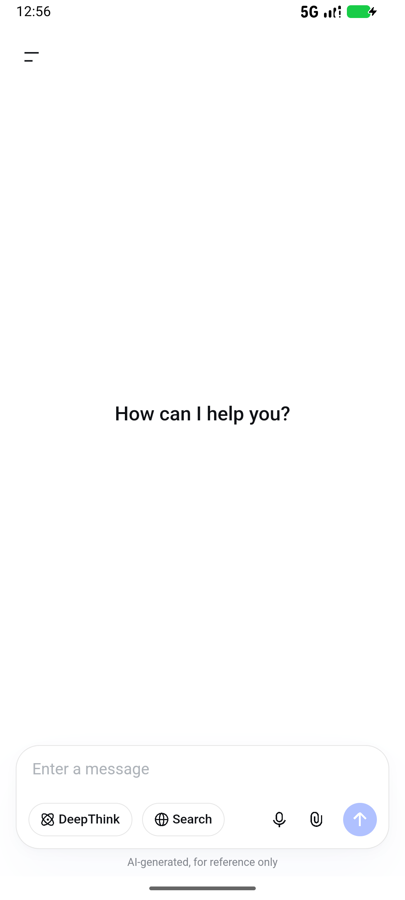

# DeepSeek ChatBot（Android）

[English](README.en.md) | 简体中文

把 [deepseek-ai/chat-demo](https://github.com/deepseek-ai/chat-demo) 0.1.1 原样装进 Android：
**上游前端产物 + 一层 Kotlin WebView 壳**，不重写界面，也不改协议。



| | |
| --- | --- |
| 包名 | `com.deepseekchatbot` |
| 版本 | 1.0.0（versionCode 1） |
| 体积 | 4.5 MB（release） |
| SDK | minSdk 26 / targetSdk 36 / compileSdk 36 |
| 原生依赖 | 仅 androidx（webkit / browser / activity / core-splashscreen），无第三方运行时 |
| 构建工具链 | Gradle 8.14.4 · AGP 8.13.0 · Kotlin 2.3.0 · JDK 17+ |

## 为什么是 WebView 壳

上游是纯静态 SPA：`rspack` 打成静态文件、没有后端，状态全在 localStorage 与 IndexedDB，请求直连 DeepSeek API。
它跑进 WebView 只差六件「浏览器有、WebView 没有」的能力；重写成 Kotlin 反而要丢掉 Markdown、KaTeX、Mermaid、历史导入导出那一整套实现。
所以这里只补壳，不动业务。

## 功能

界面能力全部来自上游：多会话与自动标题、编辑提问、重新生成、消息分支、流式回答、深度思考、智能搜索与来源引用、
附件上传（粘贴/拖拽）、语音输入与朗读、Markdown / 代码高亮 / KaTeX 公式 / Mermaid 图表、中英文、浅色深色、历史导入导出（ZIP）。

壳补上的部分：系统返回键、状态栏配色、安全区与键盘避让、麦克风权限、文件选择、导出落盘、外链。

## 环境要求

- Node.js 22+ 与 pnpm
- JDK 17+（本仓库用 21 构建）
- Android SDK：platform `android-36`、build-tools `36.1.0`

## 构建

```bash
scripts/build-apk.sh release        # 或 scripts/build-apk.sh debug
```

脚本做三件事：`web/` 里跑 `pnpm build` → 把 `web/dist` 同步到 `android/app/src/main/assets/www` → `./gradlew assembleRelease`。
产物：

```
android/app/build/outputs/apk/release/DeepSeekChatBot-v1.0.0-release.apk
```

手动分步：

```bash
cd web && pnpm install && pnpm build
rm -rf ../android/app/src/main/assets/www && mkdir -p ../android/app/src/main/assets/www
cp -r dist/. ../android/app/src/main/assets/www/
cd ../android && ./gradlew assembleRelease
```

> 构建前别用静态服务器占着 `web/dist`：rspack 会清空输出目录，Windows 下直接报 `EBUSY`。

## 安装

```bash
adb install -r android/app/build/outputs/apk/release/DeepSeekChatBot-v1.0.0-release.apk
```

首次启动会要求填 API Key（设置 → 数据管理）。Key 只写在本机 WebView 的 localStorage，不进云备份（`allowBackup=false`）。

侧载提示：vivo / OriginOS 需要关闭「纯净模式」并允许安装未知来源。
**同一 `applicationId` 必须始终用同一个 keystore 签名**，否则只能卸载重装，本地会话与 Key 会一起清空。

## 签名

`android/local.properties`（已 gitignore，模板见 `android/local.properties.template`）读取四项：

```
KEYSTORE_FILE / KEYSTORE_PASSWORD / KEYSTORE_ALIAS / KEY_PASSWORD
```

缺任一项时 `assembleRelease` 仍会出包，但没有签名。本仓库生成的那套 jks 与口令记在 `android/KEYSTORE_INFO.txt`（同样不进版本库），
请自行备份——丢了就无法覆盖升级。

## 壳实现了什么

| 问题 | 做法 |
| --- | --- |
| 页面 origin | `WebViewAssetLoader` 把 `assets/www` 挂到固定的 `https://appassets.androidplatform.net/assets/www/index.html`。不能用 `file://`：Chromium 在 file 下禁用 IndexedDB，且 `crypto.randomUUID`、`navigator.clipboard`、`getUserMedia` 都要求安全上下文 |
| 麦克风 | `onPermissionRequest` + 运行时 `RECORD_AUDIO` 授权 |
| 文件选择 | `onShowFileChooser` + `ACTION_OPEN_DOCUMENT`，把页面上的扩展名白名单映射成 MIME |
| 导出 ZIP | WebView 会静默丢弃 `blob:` 的 `<a download>`；改成 JS→原生桥，分片 base64 交给 SAF `ACTION_CREATE_DOCUMENT` 写入用户选定的位置 |
| 外链 | `window.open` / `target=_blank` / 普通外链统一用 Custom Tabs 打开，不在壳里开新 WebView |
| 返回键 | 页面把「有弹层」状态推给原生，原生同步决定关弹层还是退出（不用异步 JS 回调） |
| 系统栏与键盘 | 由容器 padding 留出状态栏、导航栏与输入法高度；状态栏字色随页面主题反色 |
| 深浅色 | `values/` 用浅色基主题、`values-night/` 用深色基——WebView 的 `prefers-color-scheme` 取自应用主题而非系统 uiMode |

## 仓库结构

```
web/        上游 chat-demo 0.1.1 源码；相对上游的改动见 web/PATCHES.md
android/    Kotlin WebView 壳（Gradle 工程）
scripts/    build-apk.sh：构建 Web → 同步 assets → 出 APK
docs/       截图
references/ 上游原始压缩包与图标素材（不进版本库）
```

## 已知限制

- **后台 / 锁屏**：WebView 会被系统节流，长时间生成可能中断；「锁屏继续跑」需要前台服务，未实现。
- **系统深色模式**：页面按启动时的系统主题渲染（`configChanges` 含 `uiMode`，为的是不重建 Activity、不丢流式回复），
  运行中切系统主题要重启应用才生效；应用内「设置 → 主题」可立即切换。
- 大附件（几十 MB）经 SAF 进内存再上传，低端机有 OOM 风险（已开 `largeHeap`）。
- 只支持 DeepSeek 官方接口（`/anthropic/v1/messages`、`/anthropic/v1/files`、`/v1/tools/asr|tts`）；
  换 OpenAI 兼容端点需要改 `web/src/services/api/`。
- 没有 iOS 版本：同样六项能力在 iOS 上要另写一份。

## 验证状态

在 Android 16（API 36.1，x86_64 模拟器）上核对过：页面 origin 与安全上下文、流式端点的 CORS 与 401 错误映射、
ZIP 导出落盘（下载文件 md5 与源数据一致）、麦克风授权链路、文件选择、外链进入 Custom Tabs、返回键三级行为、
浅色深色与状态栏反色、安全区与键盘不双留白。真机（iQOO 9 / OriginOS）待安装后确认。

## 许可证

[MIT](LICENSE)。`web/` 是 [deepseek-ai/chat-demo](https://github.com/deepseek-ai/chat-demo) 的衍生副本，
其 MIT 声明保留在 `web/LICENSE`，并随构建产物分发。图标与 DeepSeek 品牌仅用于个人侧载。
