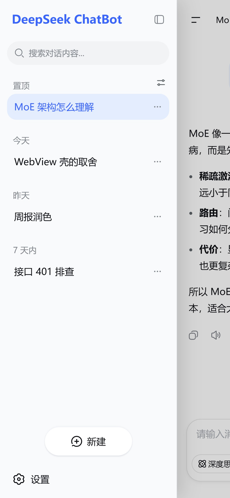
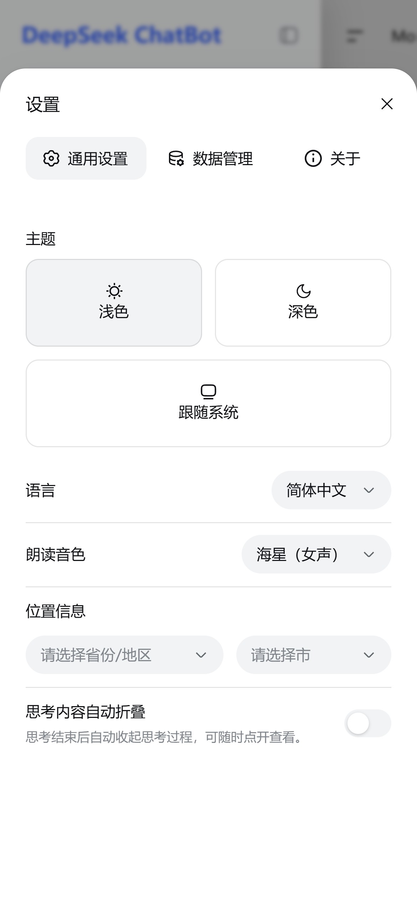
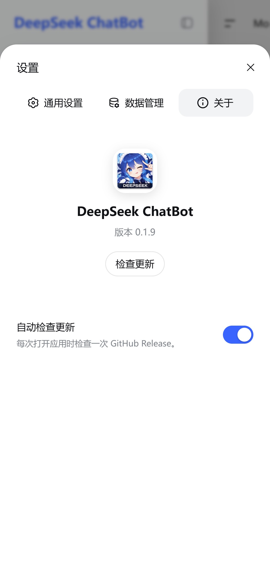

# DeepSeek ChatBot（Android）

[English](README.en.md) | 简体中文

<p align="center">
  
</p>

[](https://github.com/Jay-Victor/DeepSeek-ChatBot/releases/latest)
[](https://github.com/Jay-Victor/DeepSeek-ChatBot/releases/latest)
[](https://www.deepseek.com/)

把 [deepseek-ai/chat-demo](https://github.com/deepseek-ai/chat-demo) 0.1.3 原样装进 Android：
**上游前端产物 + 一层 Kotlin WebView 壳**，不重写界面，也不改协议。

| 会话 | 侧边栏 |
| :---: | :---: |
|  |  |

| 设置 · 通用 | 设置 · 关于 |
| :---: | :---: |
|  |  |

| | |
| --- | --- |
| 包名 | `com.deepseekchatbot` |
| 版本 | 0.1.14（versionCode 15） |
| 体积 | 5.34 MB（release） |
| SDK | minSdk 26 / targetSdk 36 / compileSdk 36 |
| 原生依赖 | 仅 androidx（webkit / browser / activity / core-splashscreen），无第三方运行时 |
| 构建工具链 | Gradle 8.14.4 · AGP 8.13.0 · Kotlin 2.3.0 · JDK 17+ |

## 功能

### 来自上游

- 多会话与自动标题、编辑提问、重新生成、消息分支
- 流式回答、深度思考、智能搜索与来源引用
- 附件上传（粘贴 / 拖拽）、语音输入与朗读
- 附件直接打开：图片 / PDF 新标签打开，SVG 与其他文件下载原件；搜索结果、引用与网页读取记录只接受 HTTP(S) 链接
- 长边超过 4096 像素的图片上传前等比缩小；历史图片再次引用时自动补传
- Markdown / 代码高亮 / KaTeX 公式 / Mermaid 图表
- 中英文、浅色深色、ZIP 历史导入导出

### 壳补上的部分

- **系统能力**：返回键、状态栏配色、安全区与键盘避让、麦克风、文件选择、外链
- **语音输入**：圆圈声波入口；点击切到「按住说话」，按住录音、松手转写并直接发送，上滑取消，录音浮层显示实时频谱
- **添加附件**：圆圈加号展开面板，显示手机最近照片并支持拍照 / 相册 / 文件
- **更新提示**：发现新版本时点击提示直接打开「设置 → 关于」
- **附件打开**：图片走应用内全屏预览（点图片切换原始尺寸），PDF 交给系统查看器（无查看器回退 SAF 保存），SVG / 其他文件走 SAF 下载
- **导出**：ZIP 与附件下载走 SAF 落盘（WebView 会丢弃 `blob:` 下载），保存桥按文件 MIME 创建文档
- **移动端侧边栏**：会话搜索（标题 + 当前分支正文，命中高亮）、底部浮动「新建」、多选批量置顶 / 删除
- **会话页顶栏**：自动朗读开关；开启后每条新完成的回复自动朗读，切换时在屏幕中央显示 1.6 秒提示
- **会话三点菜单**：置顶 / 取消置顶、多选
- **设置与关于**：思考内容自动折叠、上下文占用环（DeepSeek-V4 分词器，1M 窗口）、版本与更新检查、应用内下载安装
- **上下文与压缩**：设置里可开启自动压缩并设置压缩阈值 / 目标（默认 50% / 20%）；占用卡片可手动「压缩对话」，查看进度与摘要、随时撤销；消息列表在覆盖点显示「已压缩」分隔条

## 快速开始

从 [Releases](https://github.com/Jay-Victor/DeepSeek-ChatBot/releases/latest) 下载签名 APK，或：

```bash
adb install -r DeepSeekChatBot-v0.1.14-release.apk
```

首次启动在「设置 → 数据管理」填入自己的 DeepSeek API Key；Key 只写在本机 WebView 的 localStorage，不进云备份（`allowBackup=false`）。

**同一 `applicationId` 必须始终用同一个 keystore 签名**，否则只能卸载重装，本地会话与 Key 会一起清空。

## 为什么是 WebView 壳

上游是纯静态 SPA：`rspack` 打成静态文件、没有后端，状态全在 localStorage 与 IndexedDB，请求直连 DeepSeek API。
它跑进 WebView 只差六类「浏览器有、WebView 没有」的能力；重写成 Kotlin 反而要丢掉 Markdown、KaTeX、Mermaid、历史导入导出那一整套实现。
所以这里只补壳，不动业务。

## 构建

环境要求：

- Node.js 22+ 与 pnpm
- JDK 17+（本仓库用 21 构建）
- Android SDK：platform `android-36`、build-tools `36.1.0`

```bash
scripts/build-apk.sh release        # 或 scripts/build-apk.sh debug
```

脚本做三件事：`web/` 里跑 `pnpm build` → 把 `web/dist` 同步到 `android/app/src/main/assets/www` → `./gradlew assembleRelease`。
产物：

```
android/app/build/outputs/apk/release/DeepSeekChatBot-v0.1.14-release.apk
```

手动分步：

```bash
cd web && pnpm install && pnpm build
rm -rf ../android/app/src/main/assets/www && mkdir -p ../android/app/src/main/assets/www
cp -r dist/. ../android/app/src/main/assets/www/
cd ../android && ./gradlew assembleRelease
```

> 构建前别用静态服务器占着 `web/dist`：rspack 会清空输出目录，Windows 下直接报 `EBUSY`。

## 签名

`android/local.properties`（已 gitignore，模板见 `android/local.properties.template`）读取四项：

```
KEYSTORE_FILE / KEYSTORE_PASSWORD / KEYSTORE_ALIAS / KEY_PASSWORD
```

缺任一项时 `assembleRelease` 仍会出包，但没有签名。本仓库生成的那套 jks 与口令记在 `android/KEYSTORE_INFO.txt`（同样不进版本库），
请自行备份——丢了就无法覆盖升级。

## 壳实现了什么

| 问题 | 做法 |
| --- | --- |
| 页面 origin | `WebViewAssetLoader` 把 `assets/www` 挂到固定的 `https://appassets.androidplatform.net/assets/www/index.html`。不能用 `file://`：Chromium 在 file 下禁用 IndexedDB，且 `crypto.randomUUID`、`navigator.clipboard`、`getUserMedia` 都要求安全上下文 |
| 麦克风 | `onPermissionRequest` + 运行时 `RECORD_AUDIO` 授权 |
| 文件选择 | `onShowFileChooser` + `ACTION_OPEN_DOCUMENT`，把页面上的扩展名白名单映射成 MIME |
| 导出 ZIP | WebView 会静默丢弃 `blob:` 的 `<a download>`；改成 JS→原生桥，分片 base64 交给 SAF `ACTION_CREATE_DOCUMENT` 写入用户选定的位置 |
| 外链 | `window.open` / `target=_blank` / 普通外链统一用 Custom Tabs 打开，不在壳里开新 WebView |
| 返回键 | 页面把「有弹层」状态推给原生，原生同步决定关弹层还是退出（不用异步 JS 回调） |
| 系统栏与键盘 | 由容器 padding 留出状态栏、导航栏与输入法高度；状态栏字色随页面主题反色 |
| 深浅色 | `values/` 用浅色基主题、`values-night/` 用深色基——WebView 的 `prefers-color-scheme` 取自应用主题而非系统 uiMode |

## 已知限制

- **自动朗读会产生 TTS 调用**：每条完成的回复一次，默认关闭；只读当前会话、前台完成的回复，正在朗读其他内容时不打断
- **会话搜索、置顶与多选只在移动端侧边栏**：搜索匹配标题、当前分支正文与附件名，不含思考内容；首次搜索需建本地索引，历史很多时会有短暂延迟
- **后台 / 锁屏**：WebView 会被系统节流，长时间生成可能中断；「锁屏继续跑」需要前台服务，未实现
- **系统深色模式**：页面按启动时的系统主题渲染（`configChanges` 含 `uiMode`，为的是不重建 Activity、不丢流式回复），运行中切系统主题要重启应用才生效；应用内「设置 → 主题」可立即切换
- **超过 4096 像素的动图**：上传前缩放时只保留一帧，动效会丢失（上游行为）
- **最近照片需要相册权限**：拒绝后照片条显示重试入口，拍照 / 相册 / 文件仍可用
- **系统辅助功能的「强制启用缩放」仍可放大页面**：应用内已关闭 WebView 双指缩放，但系统无障碍能力不受应用控制
- **PDF 打开依赖系统查看器**：没有可用的 PDF 应用时会弹出保存位置选择，文件仍可正常落盘
- 大附件（几十 MB）经 SAF 进内存再上传，低端机有 OOM 风险（已开 `largeHeap`）
- 只支持 DeepSeek 官方接口（`/anthropic/v1/messages`、`/anthropic/v1/files`、`/v1/tools/asr|tts`）；换 OpenAI 兼容端点需要改 `web/src/services/api/`
- 应用内更新需要访问 GitHub 资产（优先 `api.github.com` 资产入口）；受限网络可能下载失败，此时可用「在浏览器中下载」，首次安装还需在系统设置里允许未知来源
- **压缩需要额外模型请求**：摘要由模型生成，阈值设得低或会话很大时会增加 token 消耗；原始消息仍在本地，可随时撤销，但被压缩轮次只以摘要形式进入后续回答
- **压缩只覆盖当前分支**：在覆盖点之前重新生成、编辑提问或切换分支会让摘要自动失效；单条摘要记录，在另一条分支再压缩会覆盖前一条
- **ZIP 导入导出不携带压缩摘要**：归档格式与上游一致，导入后回到完整上下文
- **压缩目标是软目标**：最近一轮本身超过目标时，压缩后仍可能高于目标
- 没有 iOS 版本：同样六类能力在 iOS 上要另写一份

## 验证状态

在 Android 16（API 36.1，x86_64 模拟器）上核对过壳层：页面 origin 与安全上下文、流式端点的 CORS 与 401 错误映射、
ZIP 导出落盘（下载文件 md5 与源数据一致）、麦克风授权链路、文件选择、外链进入 Custom Tabs、返回键三级行为、
浅色深色与状态栏反色、安全区与键盘不双留白、应用内更新的下载进度 / SHA-256 与签名校验 / 未知来源授权 / 系统安装器覆盖安装。

v0.1.9 的移动端侧边栏（搜索、多选、置顶分组、批量删除、浮动新建、顶栏常驻）、会话菜单（置顶 / 取消置顶 / 多选）
与顶栏自动朗读开关（含 1.6 秒居中提示与自动朗读触发）在 390×844 视口核对；自动朗读的真实出声与真机输入法待确认。

v0.1.10 在 Android 16（API 36.1，x86_64 模拟器）上核对：6000×3000 图片上传前缩到 4096×2048、
历史图片清掉 `serverId` 后自动补传并写回新 ID、聊天记录与草稿图片的应用内预览（含返回键关闭与原始尺寸切换）、
PDF 进入系统查看器、SVG 经 SAF 保存后字节一致、ZIP 导出重新下载校验 CRC 与原件字节、`javascript:` 搜索结果与
阅读链接不渲染为可点链接；`isWebUrl` 12 条用例通过。真机网络与 IME 行为仍由发布前的设备验收覆盖。

v0.1.11 在 Android 16 模拟器上核对：圆圈声波入口与「按住说话」切换、按住录音浮层、上滑取消、mock ASR 松手后
自动发送、键盘切回；圆圈加号附件面板、相册权限允许 / 拒绝、最近照片点选、拍照、相册、文件、返回键收起；
mock Release 新版本提示整条点击后进入「设置 → 关于」。真机相机、相册权限与 IME 行为待设备验收。

v0.1.12 修复聊天页面可被双指放大的问题：viewport 增加 `maximum-scale=1,user-scalable=no`，并在 WebView 关闭
`supportZoom`。CDP 双指手势实测修复前 `visualViewport.scale` 从 1 跳到 5，修复后保持 1；图片预览的点按原始尺寸不受影响。

v0.1.13 在桌面 Chrome（1280×800 与 390×844 视口）核对压缩功能：设置默认 50% / 20% 与交叉校验、手动压缩
1.59% → 0.59%（覆盖 19 轮）、请求体（system 含摘要、旧轮次被裁掉）、撤销恢复、自动压缩打开会话时只触发一次、
在覆盖点之前重新生成后摘要失效并在切回旧版本后恢复；APK 核对 `0.1.13` / `versionCode 14` 与 v2 签名。
真机安装、数字输入法与 WebView 键盘行为待设备验收。

v0.1.14 修复移动端设置四个分组在窄屏或较大字号下文字与图标重叠：导航改为 2×2 网格，不再把每项压缩到内容宽度以下，
长标签允许换行。390×844 下以 14 / 16 / 22px 字号复验，无重叠；APK 核对 `0.1.14` / `versionCode 15` 与 v2 签名。

## 仓库结构

```
web/        上游 chat-demo 0.1.3 源码；相对上游的改动见 web/PATCHES.md
android/    Kotlin WebView 壳（Gradle 工程）
scripts/    build-apk.sh：构建 Web → 同步 assets → 出 APK
docs/       截图与按版本归档的 Release 正文
references/ 上游原始压缩包与图标素材（不进版本库）
```

## 许可证

[MIT](LICENSE)。`web/` 是 [deepseek-ai/chat-demo](https://github.com/deepseek-ai/chat-demo) 的衍生副本，
其 MIT 声明保留在 `web/LICENSE`，并随构建产物分发。图标与 DeepSeek 品牌仅用于个人侧载。

变更记录见 [CHANGELOG.md](CHANGELOG.md)。
